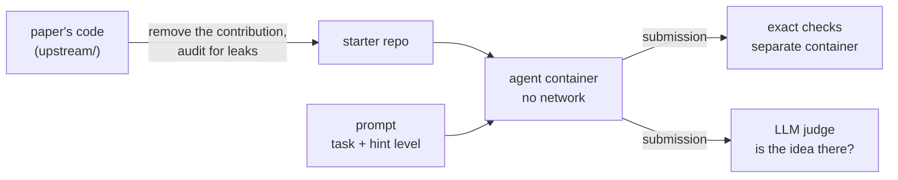

# paper2env

[](https://github.com/clementtisseau/paper2env/actions/workflows/tests.yml)

[](LICENSE)

**Can an agent rediscover a paper's key insight from what was known before it?**

Rediscovery environments, each built from one recent research paper. The
agent gets the paper's own codebase with the contribution removed, a prompt
limited to pre-paper knowledge (plus optional hints), and a sandbox. It is
graded on whether it **found the paper's idea** and **implemented it
correctly**. How depends on the paper: exact checks, an LLM judge with a hidden
rubric, or both.

> Environments are **built by hand, not generated**: choosing what to hide,
> which property to check and which wrong answers to reject means reading the
> paper closely. The shared machinery lives in [`core/`](core/); each paper
> lives in [`papers/<name>/`](papers/).

## Result: score-centering

The first environment is built from *Score Centering Stabilizes Off-policy RL*
(Marek & Ryabinin, [arXiv:2609.20807](https://arxiv.org/abs/2609.20807),
Sept. 2026). RL for LLMs **drifts** when the engine that samples rollouts
differs slightly from the trained model. The paper shows why, and removes the
drift by centering each token's score under the sampler, using only the top-k
logprobs an inference engine returns. The models tested predate it.

**What counts as a success.** Only the submitted `losses.py` is graded,
called with its default arguments. A run succeeds when both hold:

1. **The idea is found:** a majority of three LLM judges (Opus 5.5, hidden
   prompt) find that the loss centers each token's score under the sampler.
2. **It is implemented correctly:** exact checks on a toy policy confirm the
   loss is drift-free, using only the sampler's top-k logprobs.

The judge says whether the idea is there; the checks say whether it works.
[How a run is graded](papers/score-centering/grading.md)

**Successful runs by hint level** (successes / runs)

<picture>
  <source media="(prefers-color-scheme: dark)" srcset="papers/score-centering/figures/success-dark.svg">
  
</picture>

27 runs: Claude Haiku, Sonnet and Opus 5.5 as Claude Code subagents, three
runs per model and hint level, 2-hour budget. *Hint level*: how much the
prompt gives, from L1 (only what was known before the paper) to L2b (where
to look: the expected update at one token, given the prefix).

- **Opus succeeds in 9/9 runs, from pre-paper knowledge on**, including the
  top-k tail model, in a median of 13 minutes and 20 shell commands.
- **Haiku finds the idea but not the implementation:** the judge finds the
  centering in 8/9 runs, but 7 of them center over the sampler's top-k
  without modeling the tail, which is biased even on-policy.
- **Sonnet reaches for the familiar remedy:** 8/9 runs use importance
  sampling (6) or a reward baseline (2) instead; one succeeds.
- **The judges agree:** the three verdicts are unanimous on all 27 runs.

[Every run, with its transcript and grade](papers/score-centering/runs/) ·
[tables](papers/score-centering/results_tables.md)

## One episode

An Opus run at L1 ([full run](papers/score-centering/runs/20261119-103415-exp-L1/)).
The prompt describes the setting and adds only what was known before the paper:

> *The mismatch acts as a systematic bias in the training objective, not as
> zero-mean noise. [...] Importance-sampling corrections and clipping slow the
> degradation down but do not remove it.*

Fourteen minutes later, the agent's report:

> *Here the tokens come from the sampler `q != p`, and
> `E_{y~q}[grad log p(y)] = -grad KL(q || p) != 0`. Each token's update
> therefore picks up a term `V(s) * (q - p)`. [...] Center each sampled
> token's score under the distribution the token was actually drawn from.*

Judges: idea found, 3/3. Exact checks: drift-free with the sampler's top-k ✓.

## How it works



What is shared between papers and what is written for each: [docs/adding-a-paper.md](docs/adding-a-paper.md).

Why the eval is built this way, and what went wrong: [docs/method.md](docs/method.md).

## Papers

| `--paper` | Paper | Runs |
|---|---|---|
| [`score-centering`](papers/score-centering/) | Score Centering Stabilizes Off-policy RL, [arXiv:2609.20807](https://arxiv.org/abs/2609.20807) | 27 |

## Quickstart

Docker, Python 3.12, CPU only.

```bash
pip install -r requirements-host.txt
python -m pytest                       # every test, core and papers
python core/runner/run.py papers       # papers and their hint levels
```

**With an API model** ([Inspect AI](https://inspect.aisi.org.uk/); options in [`core/task.py`](core/task.py)):

```bash
inspect eval core/task.py --model <provider/model> -T paper=<paper> -T levels=<level>,<level>
```

**With Claude Code, no API key** (how every run here was made): open a session
at the repository root and follow [core/runner](core/runner/README.md).

## Limitations and status

- **Small samples:** 3 runs per (level, model); counts, not rates with
  confidence intervals. The 37 runs of an earlier version of the environment,
  kept in `runs/` as starter v1, are not counted.
- **One harness:** all runs use Claude Code's subagent harness with Bash only.
- **Judge not calibrated:** its verdicts have not yet been compared with a
  human's on a sample of runs.
- **Contamination from here on:** publishing the judge's prompt and the checks means
  future models may have seen the answer.
- **Not done yet:** GPU validation, `noexp` runs, a second paper.

## Credits

Each paper's `upstream/` belongs to its authors, under its own license
(score-centering: MIT, Martin Marek and Max Ryabinin). This repository builds
evaluations on their work and is not affiliated with them.
