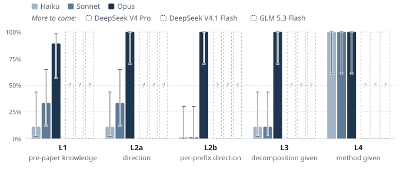
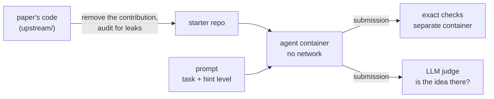

# paper2env

[](https://github.com/clementtisseau/paper2env/actions/workflows/tests.yml)
[](LICENSE)

**Can an agent rediscover a paper's key insight from what was known before it?**

Rediscovery environments, each built from one recent research paper. The
agent gets the paper's own codebase with the contribution removed, a prompt
limited to pre-paper knowledge (plus optional hints), and a sandbox. It is
graded on two questions: did it find the paper's idea, and did it implement
it correctly.

> Environments are **built by hand, not generated**: choosing what to hide,
> which property to check and which wrong answers to reject means reading the
> paper closely.

## Papers

| `--paper` | Paper | Runs |
|---|---|---|
| [`score-centering`](papers/score-centering/) | Score Centering Stabilizes Off-policy RL, [arXiv:2609.20807](https://arxiv.org/abs/2609.20807) | 81 |
| | *more to come* | |

## Result: score-centering

When the inference engine that samples rollouts differs slightly from the
model being trained, RL for language models drifts and often collapses. The
paper shows why, and fixes it in the loss: from each token's gradient, it
subtracts that gradient's average under the sampler, using only the top-k
logprobs an inference engine returns.

The agent gets 2 hours, Bash in a sandbox, and a small CPU version of the
training to experiment with. Its prompt states the problem, then adds hints
by level, each level including the previous ones:

- **L0:** the problem only: training collapses when the sampler differs from the model.
- **L1:** what was known before the paper: a systematic bias, not noise;
  importance sampling and clipping slow it down without removing it.
- **L2a:** where to look: the expected update under the sampler, on- vs off-policy.
- **L2b:** at one token, given the prefix.
- **L3:** the answer to that analysis (a drift term plus the useful signal),
  and that the batch holds the sampler's top-20 logprobs.
- **L4:** the method itself.

These runs cover L1 to L2b. A run succeeds when LLM judges find the paper's
idea in the submitted loss and exact checks confirm it is correct with the
sampler's top-k ([how a run is graded](papers/score-centering/grading.md)).

<picture>
  <source media="(prefers-color-scheme: dark)" srcset="papers/score-centering/figures/success-dark.svg">
  
</picture>

*Success rate by hint level and model: Claude Haiku, Sonnet and Opus 5.5
as Claude Code subagents, 9 runs each; whiskers: 95% Wilson intervals.*

- **Opus succeeds in 26 of 27 runs, from L1**, top-k tail included, in a
  median of 12 minutes and 17 shell commands; its one failure drops the tail.
- **Haiku finds the idea but not the implementation:** the judges find it
  in 23/27 runs, but 20 of them center over the sampler's top-k without
  modeling the tail, which is biased even on-policy.
- **Sonnet reaches for the familiar remedy:** 20/27 runs use importance
  sampling (17) or a reward baseline (3) instead; 6 succeed.
- **The most precise hint makes Sonnet worse:** 0/9 at L2b against 3/9 at
  L2a. Asked to analyze one token's update under the sampler, it answers in
  under 2 minutes without running anything, and reweights by p/q: unbiased,
  but with unbounded gradients. Its L2a successes all came after experiments.

Detailed results, one episode and every run: [papers/score-centering](papers/score-centering/README.md)

## How it works



Why the eval is built this way, and what went wrong: [docs/method.md](docs/method.md).
What is shared between papers and what is written for each: [docs/adding-a-paper.md](docs/adding-a-paper.md).

## Quickstart

Docker, Python 3.12, CPU only.

```bash
pip install -r requirements-host.txt
python -m pytest                       # every test, core and papers
python core/runner/run.py papers       # papers and their hint levels
```

**With an API model** ([Inspect AI](https://inspect.aisi.org.uk/); options in [`core/task.py`](core/task.py)):

```bash
inspect eval core/task.py --model <provider/model> -T paper=<paper> -T levels=<level>,<level>
```

**With Claude Code, no API key** (how every run here was made): open a session
at the repository root and follow [core/runner](core/runner/README.md).

## Limitations

- **Possible contamination:** the models tested were released a few days
  after the paper and may have seen it; two Haiku reports even name the
  method. Runs with open-weight models released before the paper are planned.
- **Small samples:** 9 runs per model and level, so the 95% intervals are
  wide (3/9 spans 12–65%): the gap between Opus and the others is clear, the
  differences between levels are not. 37 runs of an earlier version of the starter are kept
  in `runs/` but not counted.
- **One harness:** all runs use Claude Code's subagent harness, Bash only.
- **Judge checked by hand:** the three judges agree on all 81 runs, and every
  verdict read by hand was right.
- **Published answer:** the judge's prompt and the checks are public, so
  future models may have seen them.

**Status:** not done yet: GPU validation, `noexp` runs, a second paper.

## Credits

Each paper's `upstream/` belongs to its authors, under its own license
(score-centering: MIT, Martin Marek and Max Ryabinin). This repository builds
evaluations on their work and is not affiliated with them.
