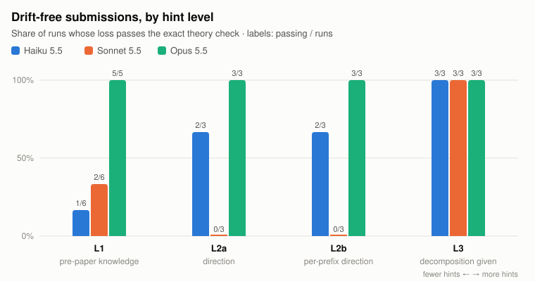

# score-centering

*Score Centering Stabilizes Off-policy Reinforcement Learning*, Martin Marek
and Max Ryabinin, [arXiv:2609.20807](https://arxiv.org/abs/2609.20807),
September 2026. Code: [`upstream/`](upstream/), untouched (MIT).

```bash
python core/runner/run.py start --paper score-centering --level L1 --hours 2   # Claude Code subagent
inspect eval core/task.py -T paper=score-centering -T levels=L1,L3 --model ...  # API model
```

How to run either: [top-level README](../../README.md#running).

## The paper

When RL for LLMs samples rollouts with an inference engine that differs
slightly from the trained model (quantization, kernels, stale weights),
training drifts and often collapses. The paper shows why and fixes it with
one line of math:

- At a prefix h, the expected REINFORCE update under the sampler q splits
  into **E_q[A | h] · s̄(h)**, a drift along the sampler's expected score
  s̄(h) = Σ_v q(v|h) ∇log p(v|h), plus **Cov_q(A, s_y | h)**, the signal.
  On-policy s̄ = 0; off-policy it is not, and the drift compounds because the
  sampler is rebuilt from the trainer every step.
- **Fix:** replace each token's score s_y by s_y − s̄(h), through a scalar
  surrogate with stop-gradients, with a model of the tail when the engine
  returns only its top-k logprobs.

A good target: the problem was widely studied before the paper (importance
sampling, clipping, "a systematic bias, not noise"), the fix is a small change
to the loss with an exact correctness criterion, and the models tested
predate the paper.

## Results

<picture>
  <source media="(prefers-color-scheme: dark)" srcset="figures/results-dark.svg">
  
</picture>

45 runs, Claude Haiku / Sonnet / Opus 5.5 as Claude Code subagents, `exp`
mode. Drift-free submissions / runs:

| Level | Haiku | Sonnet | Opus |
|---|---|---|---|
| L3: decomposition given | 3/3 | 3/3 | 3/3 |
| L2b: per-prefix direction | 2/3 | 0/3 | 3/3 |
| L2a: direction | 2/3 | 0/3 | 3/3 |
| **L1: pre-paper knowledge only** | 1/6 | 2/6 | **5/5** |

Opus rediscovers the method from L1 in 5/5 runs, including the top-k tail
model. Weaker models find the right diagnosis, then the familiar remedy
(importance sampling). Analysis and limitations: [results.md](results.md) ·
every run: [tables](results_tables.md), [`runs/`](runs/).
After new runs:
`python papers/score-centering/summarize_runs.py > papers/score-centering/results_tables.md`
and `python papers/score-centering/plot_results.py`.

## The environment

| Interface ([`paper.py`](paper.py)) | Value |
|---|---|
| Levels | `L0 L1 L2a L2b L3 L4` (default: `L2a L2b L3 L4`) |
| Modes | `exp`: the starter has `run_dev.sh` and `dev/mini.py` (a CPU run of the setting); `noexp`: without |
| Submission, report | `losses.py` (signature of `loss_fn_rl` fixed, change active by default), `REPORT.md` (derivation; optional `## Configuration` with `rl.is.*` keys) |
| Graders | `theory` (exact check, main signal), `guard` (CPU training run) |

**What the agent gets.** A real JAX RL framework: `train_rl.py` trains
Qwen3-0.6B on Countdown with a deliberately mismatched sampler, with every
importance-sampling variant already implemented (TIS, MIS, PPO, DAPO, GSPO,
TOPR, DPPO), and the method removed. In `exp` mode, `run_dev.sh` runs the
same kind of mismatch on a tiny transformer sorting digits ([`mini/`](mini/))
in a few minutes.

### Hint levels

| Level | The prompt adds ([`prompts/`](prompts/)) |
|---|---|
| L0 | Only the problem (training collapses when the sampler differs from the trainer), the deliverables and the tools. |
| L1 | What was known before the paper: a systematic bias, not noise; IS corrections and clipping slow it down but do not remove it. |
| L2a | Analyze the expected update under the sampler, on- vs off-policy. |
| L2b | At one token position, conditionally on the prefix. |
| L3 | The decomposition E_q[A s_y \| h] = E_q[A\|h]·s̄(h) + Cov_q(A, s_y \| h), and that the batch holds the sampler's top-20 logprobs. |
| L4 | The method: subtract s̄(h), the scalar surrogate, the top-k tail model. |

[`tests/test_prompts.py`](tests/test_prompts.py) checks that no level says
more than it allows.

### Hiding the answer

[`sanitize_spec.py`](sanitize_spec.py) holds the edits; `core/sanitize.py`
applies and audits them.

| Leak | Where | Fix |
|---|---|---|
| The method's code | `losses.py` branches, a `score_center` flag | Removed by exact, SHA-pinned edits; the starter's loss equals the reference with the method off (tested on values, gradients and metrics for seven IS corrections). |
| Words | docstrings, config comments, README, names like `center_ids` | Rewritten; renamed to `sampler_topk_*`; neutral README; the audit fails the build on any revealing word. |
| Structure | `models/topk.py`, which exists only for the method | Folded into the sampler as a private helper. |
| Data plumbing | a setting that enables the sampler's distribution | Removed: the sampler always returns its top-20 logprobs, as `logprobs=20` does in an inference engine, and nothing documents them for the loss. Saying what the batch holds is an L3 hint. |
| History | git log, the paper's figure, sweeps, tests | Fresh history; `README.md`, `assets/`, `sweeps/`, `tests/` dropped. |
| Prompt | "theoretical argument", the name of the useful config key | Moved into the levels or removed. |
| The agent's context | the session's working directory contained the repository's name | Runs launched from a checkout with a neutral name; a probe subagent before runs; all 45 transcripts scanned. |

Kept on purpose: `log_mass` in `losses.py` (used by `is_weight`, a weak hint),
and the author's name in `LICENSE`, as the MIT license requires.

### Grading

Details and validation: [`grader/README.md`](grader/README.md).

1. **Theory check** ([`grader/theory/check.py`](grader/theory/check.py), CPU,
   exact): on a toy policy whose completions are all enumerated, the expected
   update has no drift at any prefix (mild and severe mismatch), is unchanged
   on-policy, and keeps per-sample gradients bounded. Reported with the full
   distribution (`passed`), the top-k only (`passed_topk`) and with TIS
   (`passed_with_tis`). Each check rejects a named wrong answer: a GRPO-style
   global baseline, unclipped or loosely capped IS, a loss that learns nothing.
2. **CPU guard-rail** ([`grader/empirical/`](grader/empirical/)): a training
   run on held-out seeds, normalized between REINFORCE (0) and the method (1).
   It cannot separate the method from TIS at CPU scale.
3. **LLM judge** ([`grader/judge/`](grader/judge/)): hidden rubric, seven
   near-misses. Built, not yet calibrated or run.

## Layout

| Path | Role |
|---|---|
| `paper.py` | What this paper declares to `core/` ([interface](../../docs/adding-a-paper.md)). |
| `sanitize_spec.py` | The edits that turn `upstream/` into the starter. |
| `upstream/` | The paper's code, untouched. |
| `starter_extra/` | Added to the `exp` starter: `run_dev.sh`, `dev/summarize.py`. |
| `starter/` | **Generated:** `exp/`, `noexp/`. |
| `prompts/` | `common.md`, one file per level, `tools_*.md` per mode. |
| `mini/` | CPU prototype of the setting; ships as `dev/mini.py`, backs the guard-rail. |
| `grader/` | Theory check, guard-rail, judge. |
| `docker/` | Agent (CPU) and grader images. |
| `tests/` | Starter equivalence, grader validation, prompt leaks. |
| `runs/` | 45 runs with prompts, transcripts and grading ([guide](runs/README.md)). |
| `summarize_runs.py` | Writes `results_tables.md` from `runs/`. |
| `plot_results.py` | Writes `figures/results-{light,dark}.svg` from `runs/`. |
